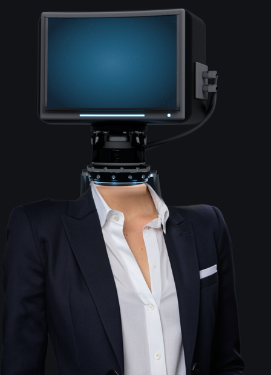
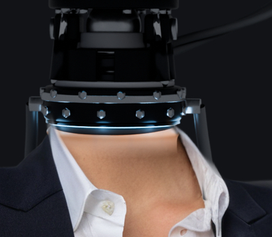

# Nine pipeline v3: review and plan

The brief: fix the join between the human body and the mechanical head, make the body more real, curve the head, replace the patched-together 360 turn, and let Nine move. This page reviews the brief against what the models can actually do, then maps the new pipeline. The code is in `pipeline/`.

## Review: where the brief needs adjusting

| Brief says | What is actually the case | What v3 does |
|---|---|---|
| A TypeScript/Bun exporter | The exporter is Python (`export_web.py`); there is no TypeScript in this pipeline | Extended `export_web.py` |
| Wan 2.2 360 Rotation LoRA with our Wan 2.2 | The LoRA ([artificialguybr/360Rotation-Redmond-WAN2-I2V-14B](https://huggingface.co/artificialguybr/360Rotation-Redmond-WAN2-I2V-14B), CC0) is for **Wan2.2-I2V-A14B**: two 14-billion-parameter experts, one LoRA file each. It does not work with the 5B model we have, and A14B cannot run on 6 GB | `gen_360_turntable.py` targets A14B with GGUF-quantised experts on a Kaggle T4; locally it is possible but very slow and untested |
| A flawless, seamless turn from one still | No model guarantees it | Two safeguards: `--close-loop` gives the still as the last frame too (`last_image`), so the turn must come back to where it started; and the prompt names the back of the head and bans flat panels |
| Wan 2.2 Animate or One-to-All 1.3B on 6 GB | Wan2.2-Animate-14B's transformer is about 69 GB in bf16: it needs a 40–80 GB GPU. One-to-All 1.3B runs on a free Kaggle T4 (16 GB) according to its authors; no 6 GB figure exists | `gen_animation.py` uses One-to-All 1.3B, targets Kaggle, with a `--local` low-resolution attempt |
| The blue light ring casts subsurface scattering onto the skin; the gasket indents the flesh | The skin is in a **photograph**; Blender cannot light or dent it | Blender now renders a short **skin section** under the ring (subsurface-scattering skin, colour sampled from the photo's neck). The gasket presses into it, the flesh bulges around the lip, the blue light scatters into it, and it fades into the photographed neck below |
| Hydraulic lines disappear into the suit | The suit is in the photograph, under the head layer | The hoses run down to the collar, and `export_web.py` makes a **collar layer** (clothes only, not skin) that goes back over the head layer, so they vanish under the shirt collar and lapels |
| The screen UI is emissive and lights the inner bezel | The face is live HTML on the website, so it cannot light the render | The rendered screen panel glows softly (bright in the middle), which lights the bezel lip; the HTML face goes on top |
| The curved head with the existing face mapping | A four-corner perspective map cannot follow a curve | `display_head.py` now writes a 9 × 5 **screen grid**; the website will draw the face in strips along it |
| Faint veins and pores on the neck | At 896 × 1152 the neck is about 180 px wide: too small for pores | `refine_neck.py` repaints only the neck skin at 4× resolution, lightly (strength 0.35), then scales it back |
| One long SDXL prompt | SDXL's text encoders read 77 tokens each and drop the rest; v1's prompt lost its end | Two prompts, one per encoder, each under 77 tokens (checked: 62 and 65) |
| Walking from the current still | Nine is waist-up: the model would invent legs and trousers, differently every clip | Gestures work from the current still; for walking, generate a full-length still first |

Also check before launch: the **One-to-All checkpoints' licence**. Its README licenses the code (Apache-2.0) but not the weights.

 

## 1. Directory structure and file mapping

```text
nime/ (this repository)
├── index.html
├── assets/nine/
│   ├── photo/        body.webp · head.webp · collar.webp (new) · nine.json (adds screen_grid, collar)
│   ├── turn/         f000.webp … · manifest.json (new: frames, fps, loop)
│   └── anim/         manifest.js (lists every clip) · <motion>/ f000.webp … · manifest.json · track.json
├── pipeline/
│   ├── gen_portrait.py        1  body photo (v2 prompts)
│   ├── remove_head.py         2  paint the head out
│   ├── refine_neck.py         3  NEW: neck skin detail pass
│   ├── matte.py               4  cut the body out (BiRefNet)
│   ├── display_head.py        5  v3: curved head, glass, heavy neck, skin section
│   ├── export_web.py          6  web layers + collar layer + screen grid; stills for video
│   ├── matting.py             NEW: shared BiRefNet + temporal smoothing + despill + web export
│   ├── gen_360_turntable.py   7  NEW: one-still 360 with the Wan 2.2 A14B LoRA
│   ├── make_drive.py          8a NEW: driving videos from the rigged Blender figure (no real person)
│   ├── gen_animation.py       8  NEW: motion transfer with One-to-All 1.3B
│   ├── o2a_runner.py          8b NEW: runs One-to-All on 6 GB, in its own environment
│   └── legacy/                the v2 turn: wan_clip.py · turn_frames.py · join_turn.py
└── docs/

nine-portrait/ (local working folder, not in git: models and large outputs)
├── .venv/                     Python 3.12, PyTorch cu128, diffusers 0.43, transformers, BiRefNet deps
├── .venv-o2a/                 Python 3.10, PyTorch 2.5.1 cu124, diffusers 0.33: One-to-All's pinned stack
├── One-to-All-Animation/      their repo, with pretrained_models/ (pose ONNX, Wan2.1-1.3B parts)
├── options/  matte/  head_v3/  final/  clips/
├── loras/360/                 the two LoRA files
└── drives/                    driving videos for animation
```

Running order: `gen_portrait` → `remove_head` → `refine_neck` → `matte` → `display_head` → `export_web` → `gen_360_turntable` → `make_drive` → `gen_animation`. All of them run on this PC (6 GB GPU); Kaggle remains the faster option.

## 2. `display_head.py` v3

The full script is `pipeline/display_head.py`. It was test-rendered on this PC (Blender 5.3, Cycles, RTX 3050, 128 samples). The key parts:

- **Curve.** Every head part is built flat, sliced into vertical strips, then bent around a vertical axis 0.7 m in front of the screen (`bend_co`), so the edges come about 2 cm toward the viewer.
- **Glass.** A real 3 mm cover sits in front of the panel. Refraction through the slab picked up the studio lights as a big bright patch, so the glass is a transparent and glossy mix with Fresnel: you see through it, and it reflects at grazing angles.
- **Panel glow.** The panel emits a soft "on" glow, brightest in the middle, which lights the inner bezel lip.
- **Mount ring.** The ring is heavy: two rows of bolts and a steel band. Its inner gasket (`GASKET_R`) is *smaller* than the neck, so it presses in.
- **Skin section** (`neck_skin`):
  - Its profile tucks under the gasket, slopes up into the metal, and bulges where the lip presses.
  - The shader has subsurface scattering, pores, tone variation and faint veins (a thin, distorted wave tinted blue-green at 22%).
  - It fades out 1–3 cm below the ring, so the photographed neck shows underneath.
- **Blue light.** A soft emissive ring and eight small blue lights just above the skin scatter blue into it.
- **Neck mechanics:** four armoured shroud plates, four pistons, servo housings at the gimbal, a rear cable loom, and two hydraulic hoses down to the collar.
- **Outputs:** the screen grid, the collar position and the hose end points, all in `display_head.json`.
- **Colour matching:** `NINE_SKIN=r,g,b` (linear) sets the skin colour. The default, 0.267, 0.117, 0.060, is the median of the photo's neck.

## 3. SDXL prompt structure (`gen_portrait.py` v2)

| Encoder | Carries | Prompt |
|---|---|---|
| CLIP ViT-L (`prompt`) | subject, framing, light that models volume | RAW photo, waist-up portrait of a 30 year old Kenyan woman with light skin, shoulders turned slightly, natural curves of shoulders, bust and waist, soft key light from the left, gentle rim light separating her from a dark grey studio backdrop, 85mm lens, shallow depth of field |
| OpenCLIP bigG (`prompt_2`) | materials, cloth, skin | tailored navy wool-blend suit jacket with visible twill weave and real weight, natural drape, soft folds at the elbows and waist, crisp white cotton shirt with fine creases, open collar, visible collarbones, real neck skin with pores, subtle tone variation and faint veins, no makeup on the neck |
| negatives | the usual, plus | shiny polyester, satin suit, stiff cardboard fabric, wrinkle-free plastic cloth … bulging veins, bruises, scars |

The script prints each prompt's token count and warns if one goes over 77. Volume comes mostly from the light: a key light from one side plus a rim light give the shoulders and waist shape against the backdrop. The neck pass (`refine_neck.py`) adds the pores and veins that the full portrait is too small to hold.

## 4. `gen_360_turntable.py`

What it does, in order:

1. **Load the model.** Wan2.2-I2V-A14B, with each expert loaded either from a GGUF file (`WanTransformer3DModel.from_single_file` with `GGUFQuantizationConfig`) or in bf16.
2. **Load the LoRA.** The high-noise LoRA goes into `transformer` and the low-noise one into `transformer_2` (`load_into_transformer_2=True`), each at 0.9.
3. **Encode the prompt once on the processor, then drop the 11 GB text encoder.** The prompt starts with the trigger "360 Rotation".
4. **Offload:** `group` (the default on 6 GB), sequential, model or none. Sequential offload does not work with GGUF weights (diffusers raises `KeyError: None` in its GGUF tensor class); group offloading streams one transformer block at a time and does.
5. **Generate.** 81 frames at 16 fps, 512 × 704, from the green-screen still. With `--close-loop`, the still is also the last frame.
6. **Make it loop.**
   - With `--close-loop`: drop the repeated last frame.
   - Without it: cut at the frame closest to frame 0, in the last third, and cross-fade six frames.
7. **Cut it out.** BiRefNet per frame, then motion-aware temporal smoothing:
   - each alpha is blended with the median of its neighbours, wrapping round because it loops;
   - but only where the picture barely moved, so moving edges stay sharp.
   - Then green clean-up, and WebP frames with a `manifest.json`.

`--dry-run` checks every input and prints the plan without loading anything.

**Run on this PC (RTX 3050, 6 GB).** Q4_K_S experts from QuantStack's GGUF repo, the A14B text encoder borrowed from TI2V-5B (the same file), group offloading, 384 × 528, 81 frames, 20 steps: about 2.5 minutes per step, 63 minutes in all. The result turns through front, side, back (the vents show) and side, and comes back to the front without a seam. It is on the site as `assets/nine/turn/` (80 frames at 16 fps). On Kaggle, use GGUF Q4_K_M experts (about 9–10 GB each) with `--offload model`. A T4 has no bf16, so the script falls back to fp16 automatically.

## 5. Gestures: what worked and what did not

**What is on the site.** The wave (and talk) clips come from the same model as the turntable, Wan 2.2 I2V-A14B, run by `gen_360_turntable.py --motion wave` (or `talk`). There is no LoRA and no driving video. The prompt describes the gesture, and the still is given as the first **and** last frame, so every clip starts and ends exactly on the photo and the site can cut back to the live still without a jump. At 384 × 528, 81 frames and 20 steps, a clip takes about 55 minutes on the 6 GB GPU (about 3 minutes per step). The model keeps the jacket, its buttons and pocket, the shirt cuff and the display intact while the arm moves.

**What did not work: motion transfer with One-to-All 1.3B** (`gen_animation.py`, kept for reference). It runs on 6 GB, at about 90 seconds per step, after the fixes below, but it could not hold Nine:

- Its pose detector finds no head (the display is not a face) and reads her jacket shoulders as arms held straight out.
- With retargeting on, every driving pose is stretched onto that wrong skeleton: arms out in a T, no wave.
- With retargeting off, the driving video framed to her neck and shoulders, and the first driving pose used as her reference pose, the motion lines up. Even so, the model turned her jacket into a cape and then a sleeveless shirt.

The model is trained on people with faces, filmed full-length or nearly so. Nine is outside that.

### `gen_animation.py` architecture (One-to-All, not used on the site)

```text
make_drive.py (Blender) ──► drives/drive_<motion>.mp4      a rigged CC0 MakeHuman figure, no real person
                                                       ▼
prepare: 16 fps, cover-crop to 384×672, padded to 4k+1 frames (81)
         Nine on green, fitted and bottom-centred on a 384×672 green canvas
                                                       ▼
One-to-All 1.3B, in its own environment (.venv-o2a), as three processes (o2a_runner.py):
   pre     pose extraction (their infer_preprocess.py)                        ~90 s
   prompt  umT5 text encoder alone on the CPU; embeddings saved to disk        once per prompt
   gen     transformer + controlnet + reference extractor, group-offloaded     ~90 s per step × 30
                                                       ▼
matte: BiRefNet + temporal smoothing + despill   (matting.py)
                                                       ▼
head track: neck centre and shoulder tilt per frame → track.json
                                                       ▼
export: f000.webp … + manifest.json (with the still's box) → assets/nine/anim/<motion>/
        and assets/nine/anim/manifest.js, which lists every clip for the website
```

- **Why One-to-All 1.3B.** It is alignment-free: Nine and the driving person needn't match in framing or build. Its code is Apache-2.0. The default checkpoint is `MochunniaN1/One-to-All-1.3b_2`, the one their inference configs are written for.
- **Driving videos without a person.** `make_drive.py` poses the rigged MakeHuman woman from `nine.blend` (our own CC0 build) and renders plain Workbench frames: `wave`, `talk` and `walk`, plus an `axes` sheet that shows which local axis bends which bone in this rig. Only the motion reaches the model.
- **Its own environment.** One-to-All pins torch 2.5.1, diffusers 0.33 and transformers 4.40, so it runs in `.venv-o2a` (Python 3.10). DeepSpeed is imported only by their training helpers and does not install on Windows; the runner puts a stub in its place while their modules load.
- **Why three processes.** Their pose models (ONNX) hold about 5 GB of GPU memory until their process exits. Their build also loads the 11 GB text encoder next to the model, and with 32 GB of RAM that swapped to disk for 38 minutes. Each stage now runs alone.
- **Fitting 6 GB.** The model is 4.7 GB on the GPU. With the activations of an 81-frame chunk it overflowed the card, and Windows silently moved 5.7 GB into shared system memory: 35 minutes per step. Group offloading keeps one block on the GPU at a time (0.3 GB at rest) and brings a step down to about 90 seconds. Two details: the controlnet and reference extractor are built in float32, so the model is cast to bf16 before offloading; and their controlnet blocks run interleaved with the main blocks, so prefetching (`use_stream`) loads the wrong block and must stay off.
- **Frame count.** Their chunking assumes 4k+1 frames (81 per chunk). An 80-frame clip fails with a tensor size mismatch (22176 against 21168), so prepare holds the last frame until the count fits.
- **Head lock.** The model also redraws the display head, and that is where drift shows. `--head-lock` writes the neck position and shoulder tilt for every frame, measured from the matte (no pose model needed), so the site could pin the crisp Blender head to the moving body.
- **Cloth.** The folds come from the reference still. One-to-All carries the clothes from the reference and deforms them with the pose, so the jacket and shirt swing and crease as she moves.
- **Framing the driving video.** `prepare` detects the neck and shoulders in the first driving frame and in the still, then scales and shifts every driving frame so the figure's neck sits on Nine's and its shoulders are as wide as hers (`--shoulder-ratio`, 0.62 of the jacket edge the detector reads). Their video comes out as [pose overlay | result] side by side; only the result is kept.
- **On the website.** `manifest.js` sets `window.NINE_CLIPS`. When Nine is asked to `wave` or `talk` and that clip has loaded, she plays it once on the turn canvas, mapped through the still's box so it starts and ends on the photo, then goes back to the live still. Without a clip she falls back to the CSS moves.

## What was tested here, and what was not

| | Status |
|---|---|
| `display_head.py` v3 | Rendered on this PC; on the site |
| `export_web.py` collar layer and screen grid | Run on this PC with the v3 head; on the site |
| `gen_portrait.py` / `refine_neck.py` | Neck pass run at strength 0.55 with grain matching; on the site |
| `matting.py` | Used for the turntable (80 frames) |
| `gen_360_turntable.py` | Run on this PC: Q4_K_S GGUF, group offload, 63 minutes; on the site |
| `make_drive.py` | wave, talk and walk clips rendered (80 frames each at 16 fps); only used by One-to-All |
| `gen_360_turntable.py --motion wave/talk` | Wave run on this PC (55 minutes) and on the site; talk generated the same way |
| `gen_animation.py` + `o2a_runner.py` | Run end to end on this PC twice; output not usable for Nine (see section 5) |
| Website: action-clip player, collar layer, LED-matrix mouth, reading the manifests | Done; the clips appear as each one is generated |
